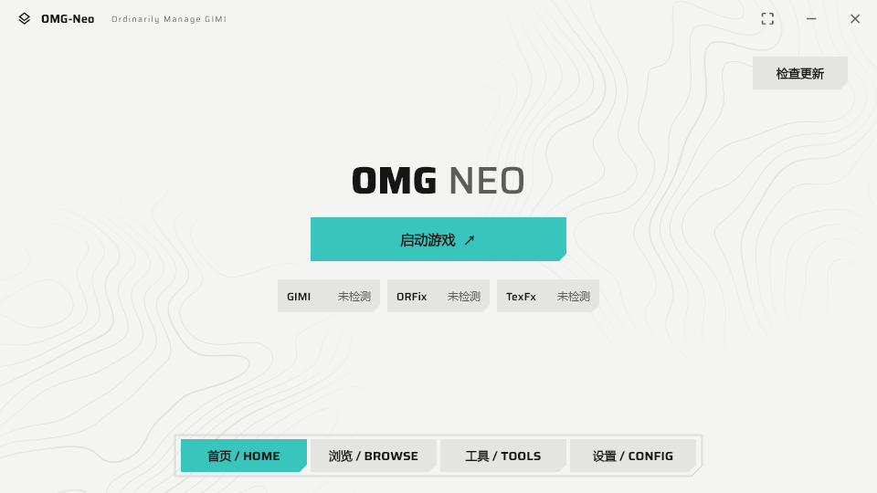
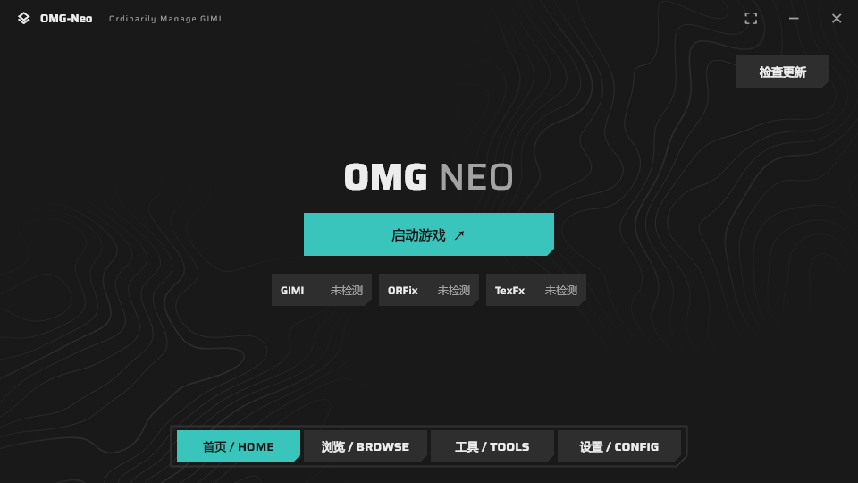
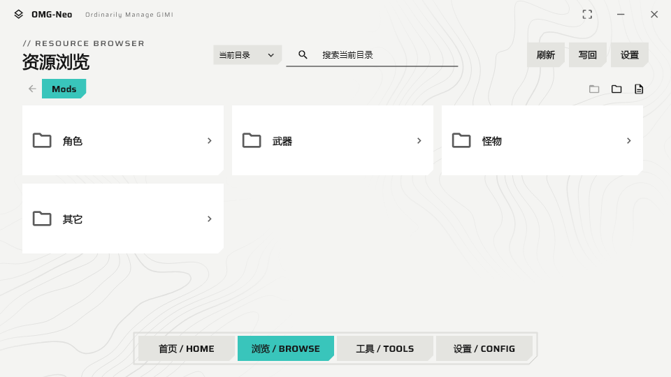
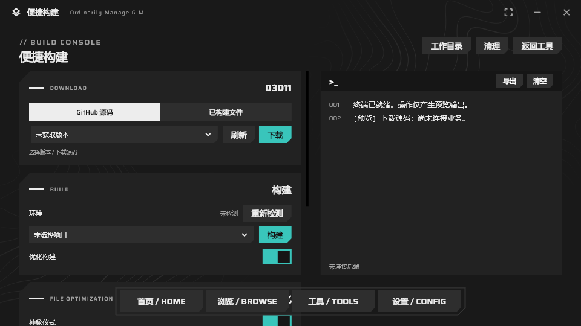
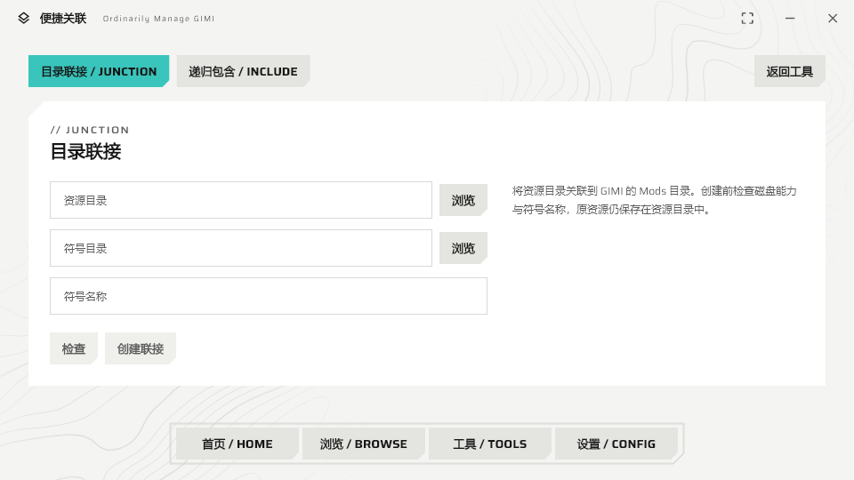
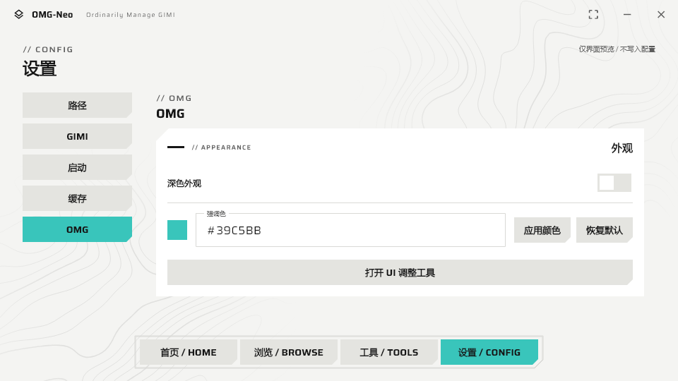

# OMG-Neo

**Ordinarily Manage GIMI** · 面向 GIMI / 3DMigoto 的 Windows 桌面管理工具

将组件更新、游戏启动、模组浏览、便捷构建和服务器切换放进同一个桌面应用。前端使用 Flutter，后端使用 Python，通过 stdio 通信；游戏注入由独立进程处理。

[使用说明](intro.md) · [手动构建指南](omg_neo/docs/手动构建指南.md) · [Agent 构建流程](omg_neo/docs/Agent构建流程.md)

本体离线更新可使用独立的 [TUI Updater](updater/README.md)：手动添加 ZIP，保留用户数据，完整备份旧目录，并支持失败恢复与程序回退。GitHub 联网更新接口暂未启用。



## 功能一览

| 功能 | 说明 |
| --- | --- |
| 首页与组件维护 | 查看 GIMI / ORFix / TexFx 版本，检查与更新 GIMI，保留白名单文件，支持取消更新。 |
| 游戏启动 | 配置启动方式、注入策略与附加 DLL，显示启动任务和游戏运行状态。 |
| 模组资源浏览 | 文件夹导航、当前目录／全局搜索、模组启停、拖放移动、缩略图和切换键预览。 |
| 便捷构建 | D3D11 源码或已构建文件、环境检测、构建与文件优化，以及终端输出。 |
| 便捷关联 | 目录联接（JUNCTION）与递归包含（INCLUDE），将外置资源接入 Mods。 |
| 服务器管理 | 原神服务器切换、版本管理、配置导入与备份。 |
| 外观与设置 | 浅色／深色主题、自定义强调色、路径和缓存管理、旧 OMGLite 配置导入。 |

## 界面截图

以下图片来自项目现有的界面预览截图。部分页面处于未连接后端的预览模式，图中的组件版本、路径及输出不代表真实游戏运行结果；实际行为以当前源码和运行环境为准。

### 浅色与深色首页

首页集中显示启动入口与组件状态，默认强调色为 `#39C5BB`。

| 浅色 | 深色 |
| --- | --- |
|  |  |

### 模组资源浏览

按文件夹组织资源，通过顶部导航和搜索定位模组。



### 便捷构建

左侧组织下载、构建和文件优化操作，右侧显示终端输出。此图为未连接后端的界面预览。



### 便捷关联与外观设置

| 目录联接 | 外观设置 |
| --- | --- |
|  |  |

## 运行方式

面向 Windows 10 / 11 x64。完整发布包包含 Flutter 应用、Python 后端和运行依赖，使用者无需安装 Python 或 Flutter。

1. 将完整发布包解压到具有写入权限的目录。
2. 双击 `omg_neo.exe`，在「设置 → 路径」中指定游戏目录和 GIMI 目录。
3. 返回首页检查组件，或进入「浏览」管理 Mods。

必须保留 `backend/`、`data/` 和所有 DLL；不能只复制 EXE。应用配置、缓存及日志保存在运行目录旁的 `AppData/`。详细操作见 [使用说明](intro.md)。

## 从源码构建

需要 Windows x64、Python **3.11 x64**、Flutter Windows SDK、Visual Studio C++ 桌面开发工具和 Windows SDK。Flutter/Dart 依赖以 `pubspec.yaml` 与 `pubspec.lock` 为准；原生 PYD 依赖对应 Python ABI。

在仓库根目录打开 PowerShell：

```powershell
python -m pip install -r backend/requirements.txt
cd omg_neo
flutter pub get

# 检查与测试
flutter analyze
flutter test --dart-define=OMG_UI_REVIEW=true --no-pub
python -m unittest discover -s ../backend/tests -p 'test_*.py'

# 构建完整分发目录，默认关闭 UI 调整工具
.\build_release.ps1 -Configuration Release
```

输出目录为 `omg_neo/dist/OMG-Neo/`，请分发整个目录。构建脚本要求目标分发目录不存在；重复构建可使用新的包名：

```powershell
.\build_release.ps1 -Configuration Release -PackageName OMG-Neo-local
```

需要 UI 调整工具时可使用 `-Configuration Debug`。工具链准备、依赖检查和手动打包步骤见 [手动构建指南](omg_neo/docs/手动构建指南.md)。

## 源码结构

```text
OMG-Neo/
├── omg_neo/                  # Flutter Windows 前端
│   ├── lib/                  # 页面、控件、后端通信
│   ├── test/                 # Flutter 测试
│   ├── windows/              # Windows runner
│   └── build_release.ps1     # 完整应用构建入口
├── backend/                  # Python stdio 服务与独立注入入口
│   ├── tests/                # 后端测试
│   ├── vendor/ritual/        # 必要原生依赖
│   └── neo_hosts.spec        # PyInstaller 打包配置
├── OMGLite/src/omg/          # Neo 所需 core / domain 源码子集及 loader 资源
├── docs/screenshots/         # README 截图
└── intro.md                  # 用户使用说明
```

共享业务代码已收录在仓库中，构建无需旁边另放一份 OMGLite。旧文档中工作区级的 `OMGLite/src` 在此仓库中位于根目录下的 `OMGLite/src`。

内置 OMGLite 已剔除未使用的旧页面控制器、窗口逻辑和媒体／模组工具，详见 [保留范围与清理记录](OMGLite/README.md)。

仓库排除构建产物、下载的构建工程、日志、缓存及本机运行配置。`backend/vendor/ritual/` 与 loader 目录中的二进制是现有运行依赖，仓库不包含这些组件的全部原生构建源码。

神秘仪式的 4 个原生依赖（`_cython_analysis.pyd`、`ritual_bundle.pyd`、`pe_diversifier.dll`、`upx.exe`）统一维护在 `backend/vendor/ritual/`，构建时由 `backend/neo_hosts.spec` 收集到发布包的 `backend/_internal/resources/binaries/ritual/`。无需将 `dist/` 中的同名副本重复提交；更新依赖时应更新 `backend/vendor/ritual/` 后重新构建。

## 许可与致谢

- 感谢 [endfield-ui-skill](https://github.com/hhikr/endfield-ui-skill) 提供的 UI 风格。
- 感谢 [XXMI-Launcher](https://github.com/SpectrumQT/XXMI-Launcher) 提供的注入方式。
- 感谢[辉夜海灵顿](https://www.homuhomu.cn/bbs/forum.php?mod=forumdisplay&fid=39)提供的服务器切换方法和替换包制作方法。
- 共享 OMGLite 代码保留原始 [MIT 许可](OMGLite/LICENSE)。
- Saira 字体使用 [SIL Open Font License](omg_neo/fonts/Saira-OFL.txt)。
- GIMI、3DMigoto 及相关组件属于各自项目；使用或分发时请遵循对应许可。
