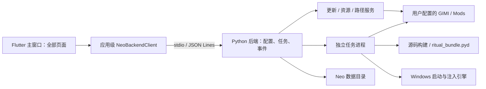

# OMGNeo 业务接线方案

初稿：2026-10-20；修订：2026-10-21。范围：当前工作区中的 OMGLite、OMGLite-ritual 与 OMG-Neo/omg_neo。此次修订按资源浏览已并回主窗口、仅保留文件夹模式的现状调整架构。

本方案基于本地源码静态分析；没有执行更新、构建、仪式、注入、资源写回或清理，也没有验证现有二进制可运行性。下文明确区分现有能力与拟新增接口。保留当前未提交修改，不以 Git HEAD 替代工作区源码。

实施进度（2026-10-21）：首页与设置的第一批接线已实现，实际范围和验证见 [首页与设置接线](首页与设置接线.md)。本方案其余内容仍为目标设计；本轮暂保留 QtCore 复用启动编排，未实现通用任务持久化、事件重放、任务进程池或跨实例激活。

## 1. 架构决定

采用 **Flutter UI → 本机 Python 服务 → 现有 Python 业务 / 私有 ritual 编译包**。

首轮保留 Python 业务资产，抽离 Qt 编排；不把 `.pyd` 当成可供 Dart FFI 直接调用的普通 DLL。Python 后端由 Flutter 应用启动并通过 stdio 持续通信，不安装为系统服务。首页、浏览、工具、设置共享一个应用级客户端与仓库。



`main.dart:openResources()` 当前执行 `go(1)`；`ResourcesDraft` 由 Workspace 持有，`ResourceBrowser` 已位于 `resources_ui.dart`。旧 `--resources` 仅将初始分页设为浏览，不创建独立资源进程。因此首版无需 TCP 端口、endpoint 文件、token、客户端租约或跨窗口主题广播；用单一长驻 stdio 后端即可维持任务和启动监视状态。

页面切换不重启后端，也不销毁应用级仓库；每次按钮点击临时执行 Python 仍会丢失连续任务状态，不采用此方式。

服务负责配置、文件写操作调度和任务真相；Flutter 负责控件、原生路径选择、窗口行为和动画。构建、仪式、启动等长任务用任务进程隔离；任务进程只返回事件及产物信息，不能自行保存共享配置。

## 2. 三个项目的实际边界

| 项目 / 文件 | 源码现状 | Neo 接法 |
| --- | --- | --- |
| `OMGLite/core/paths.py` | 无 Qt，但配置依赖 `sys.argv[0]`，导入时创建日志目录 | 改为启动前注入路径上下文 |
| `core/config.py` | 配置白名单持久化、备份恢复、版本探测；有可选 Qt 信号与异步探测 | 复用迁移规则，改为服务单写者与版本化快照 |
| `core/download.py`、`lanzou.py` | 下载、代理候选、重试、蓝奏云解析 | 在任务线程 / 进程复用，进度转标准事件 |
| `core/source_prep.py`、`build_env.py` | 源码预处理、工具链与项目检测；后者部分依赖 ritual 导出 | 复用纯业务与结构化结果，环境检测不因 ritual 缺失全部失效 |
| `core/alchemy.py` | 同步业务函数与 `QThread/Signal` 混在同一模块 | 抽成 `BuildService` 与 `RitualService`；不复用 QThread 包装 |
| `core/gimi_update.py`、`updates.py` | 检查 / 下载 / 白名单部署 / 回退；包含 Qt 包装或桌面启动辅助 | 提取更新业务，保留部署与回退规则 |
| `core/mods_manager.py`、`gachabase.py` | 扫描、分类、索引、缩略图路径、切换键、启停、差分写回 | 首版复用文件夹浏览所需函数，自动分类与角色网络目录不进入首版链路 |
| `domain/settings.py` | `SettingsController` 直接绑定 Qt 控件、对话框与 QTimer | 只迁移字段映射和 INI 写策略，重写控制器 |
| `domain/launch/controller.py`、`worker.py` | 任务快照、预检、INI patch、状态机、退出监视；依赖 Qt | 提取任务装配与执行函数，服务维护状态机 |
| `domain/inject/*` | 主要是 ctypes、子进程与进程探测 | 在 Python 任务进程中保留；不搬到 Flutter |
| `pages/quick_build.py` | 还有自动化串联、构建选项记忆、清理扫描 / 删除等业务 | 这些需额外抽离，不能只接 alchemy 就算完成 |
| `OMGLite-ritual/ritual_build/*` | Nuitka 重导出垫片和构建脚本 | 继续私有构建，按版本清单发布二进制 |
| Neo `main.dart`、`home_ui.dart`、`resources_ui.dart` | 主窗口四页导航；资源页已独立成组件，仍使用内存预览数据；首页业务、关联和写回为预览 | 在应用根注入一个客户端、控制器与仓库集合 |
| Neo `build_ui.dart`、`settings_ui.dart` | `BuildDraft` / `SettingsDraft` 只维护界面内存 | 保留编辑草稿，读取服务快照、提交真实操作 |
| Neo `update_preview.dart` | Timer 模拟约 2.6 秒完成，版本行显示固定值 | 保留视觉组件，状态改由真实任务驱动 |

表中的 OMGLite Python 文件均相对 `OMGLite/src/omg/`；Neo Dart 文件相对 `OMG-Neo/omg_neo/lib/`。

## 3. 接线前必须处理的问题

### 3.1 源码构建入口断开

`alchemy.build_project()` 仍执行 `from omg.domain.ritual import d3d11_builder`，但 OMGLite 当前目录没有 ritual 源码。编译入口 `ritual_bundle.py` 和 `build_ritual.py:REQUIRED_SYMBOLS` 都没有 `run_build`。因此，不能依据 README 的“全部编译进 pyd”就认定公开宿主的构建链路完整。

建议最小修复：私有 bundle 导出 `run_build`，同时更新必需符号清单；公开构建服务改调 `load_ritual_bundle().run_build(...)`。发布时对实际 pyd 做加载与符号检查，检查失败必须使打包失败，现有 `_verify_exports()` 仅警告不够。

当前普通构建也走私有 builder，所以首版如缺少 bundle，应明确禁用源码构建、优化构建和仪式。下载与资源功能仍可用。后续可将普通 MSBuild 执行与工具链定位迁入公开业务层，使普通构建独立于私有包；这属于后续重构，不宣称当前已经支持。

### 3.2 资源位置与可写目录混用

`alchemy.ALCHEMY_DIR` 当前位于 `RESOURCES_DIR/alchemy`；配置、日志、角色缓存又从旧 exe / argv 路径计算。Neo 换入口后直接 import 会产生新路径，甚至写进发布资源目录。

新增 `PathContext`，在业务导入前确定 `app_root`、`resource_root`、`data_root`、`task_root`。逐步让业务构造器接收上下文；过渡期只能通过单一兼容模块提供旧常量，不能在导入完后四处 monkey patch。

### 3.3 Qt、日志与运行时耦合

- 抽出 `ProgressSink`、`CancelToken`、任务返回类型，替代 `QObject/QThread/Signal/QTimer`。
- 不直接 import `omg.app` 或 `omg.pages`；这些会连带加载旧 UI。
- `logging_setup.py` 导入即重定向 stdout。后端与任务进程的 stdout 必须专用于 JSON Lines，所有普通 print 进入日志 / stderr；过渡适配需先保存专用协议输出句柄，再导入旧模块，并对输出加锁。Flutter 持续消费 stderr，避免管道阻塞。
- `process_waiter.py` 使用 multiprocessing。冻结入口必须正确处理 `freeze_support()`，不能在 spawn 子进程导入时重新进入后端协议循环。
- Windows 注入的 loader 身份应是实际执行注入的宿主进程名。任务进程使用 `omg_backend.exe --worker` 时，写入的是该 exe 名，不能硬编码为 `omg_neo.exe`。

### 3.4 不存在的能力不能补成默认含义

“便捷关联”在 Neo 只有两个路径输入和预览提示；在本次分析的 OMGLite 代码中未找到对应关联业务。首版显示“尚未实现”，不擅自将它解释为移动、复制、junction 或 symlink。后续需要定义方向、覆盖策略和解除关联语义后再实现。

## 4. 运行、连接与生命周期

1. Flutter 应用根通过绝对路径启动随包 `backend/omg_backend.exe --stdio`，隐藏控制台，使用保留 stdin/stdout/stderr 的普通子进程模式，并显式传入数据根。
2. 应用只持有一个 `NeoBackendClient`，负责 stdout 按行解码、stdin 串行写入、stderr 日志收集和后端退出检测。hello 握手校验协议与能力；不开放监听端口。
3. 首页、浏览、工具、设置通过应用级仓库共享配置、资源与任务。主题在进程内立即更新，保存成功后保留到下次启动，不需要跨进程广播。
4. 切换分页只挂载 / 卸载视图与订阅，保留浏览目录、搜索、滚动位置和进行中的任务。旧 `--resources` 只用于设置初始分页。
5. 正常关闭时先停止接受新任务、flush 配置与待写 INI，并协作取消可取消任务。若存在不可取消的构建 / 仪式 / 注入或回退阶段，显示收尾状态并等待安全边界，完成后发送 shutdown、关闭管道并回收后端。关闭 UI 不终止已启动的游戏。
6. 父进程意外退出时，后端根据 stdin EOF 进入同样的收尾路径，不接受新操作、不启动自动化后续步骤；当前不可取消阶段收尾后退出。仅有游戏监视时可立即结束监视，不等待游戏退出。
7. 单次 RPC 超时不代表任务失败，先按 taskId 查询。后端崩溃后旧连接失效；客户端可重新启动后端并重新握手、加载快照。持久化旧任务标记 interrupted，检查工作区和产物，写操作不自动重放。正常管道关闭不能被自动恢复逻辑再次拉起。

应用单实例使用 Neo 独立标识，第二次启动应激活已有主窗口；带 `--resources` 时请求已有窗口切到浏览页。跨应用实例的激活仅传导航意图，不承载业务。后端仍按“当前用户 SID + 会话 + 规范化数据根”持有数据根独占锁，作为重复启动防护；未获得锁则明确报占用，不能并发写文件。该锁不用于共享 stdio 后端。

## 5. 拟新增协议 v1

使用 stdin/stdout 上的 UTF-8 JSON Lines，允许多个未完成请求并按 id 匹配响应；日志中的换行必须作为 JSON 字符串转义。限制单行大小（建议 1 MiB），资源列表分页（默认 200 项），文件和缩略图不塞进 JSON。缩略图返回经过根目录约束的本地绝对路径，由 Flutter 读取。

以下为新协议示例，不是已有 API：

```json
{"v":1,"id":"r1","method":"hello","params":{"protocol":1,"clientId":"main"}}
{"v":1,"id":"r1","result":{"protocol":1,"capabilities":{"build":true,"ritualPaintRs":true},"configRevision":12,"eventSeq":90}}
{"v":1,"id":"r2","method":"build.start","params":{"requestKey":"<uuid>","configRevision":12,"projectId":"p1","optimize":false}}
{"v":1,"id":"r2","result":{"taskId":"t1","state":"queued"}}
{"v":1,"seq":91,"event":"task.progress","data":{"taskId":"t1","phase":"build","progress":0.34,"cancellable":false}}
{"v":1,"seq":92,"event":"task.finished","data":{"taskId":"t1","state":"succeeded","result":{"artifactId":"a1"}}}
{"v":1,"id":"r3","error":{"code":"CONFIG_CONFLICT","message":"配置已更新，请刷新","details":{"revision":13},"retryable":true}}
```

- API 进度统一 `0..1`，未知为 `null`；适配旧层 `0..100` 与解压回调 `0..1`，不能混传。
- RPC 响应区分“接受任务”和“执行完成”。任务状态为 `queued/running/cancelling/succeeded/failed/cancelled/interrupted`，终态只发一次；日志按任务分页查询。
- 服务串行分配递增 seq。订阅从握手返回的 seq 之后补发，避免快照与订阅之间丢事件；超出事件缓冲时返回 `RESYNC_REQUIRED`，客户端重新读取配置 / 任务 / 资源快照。
- 高频进度合并至每任务约 10 次/秒；终态与错误事件不合并、不丢弃。慢客户端不能阻塞任务执行。
- `requestKey` 用于写操作去重；重连重试返回已有任务，不再执行一次。去重元数据与任务记录持久化；服务崩溃恢复时返回 interrupted，不能凭旧 key 宣称成功。
- 能力按实际依赖探测：bundle 加载、必需符号、CPython/架构、UPX、Rust DLL、loader 各自报告可用性与原因。文件存在不等于能力可用。

| 拟新增接口组 | 主要方法 | 业务映射与结果 |
| --- | --- | --- |
| 基础 | `hello`、`state.get`、`events.subscribe`、`shutdown` | 协议、能力、状态快照、事件补发与安全关闭 |
| 配置 | `config.get`、`config.patch`、`config.importLite` | revision + 字段补丁；校验 / 迁移 / 持久化 |
| 版本与更新 | `versions.detect`、`updates.check`、`updates.apply` | paths 版本读取、gimi_update、updates 部署 |
| 下载 | `sources.listReleases`、`sources.download`、`prebuilt.download` | alchemy / download / lanzou |
| 构建 | `projects.list`、`environment.check`、`build.start` | source_prep、build_env、修复后的 run_build |
| 仪式与部署 | `ritual.start`、`artifacts.list`、`gimi.deployArtifact` | run_ritual、按 artifactId 部署，禁止依赖“最后一次路径” |
| 自动化 | `pipelines.start` | 服务端按任务快照串联 build → 可选 ritual → 可选部署 |
| 资源 | `resources.scan`、`resources.list`、`resources.toggle`、`resources.keys`、`resources.writeBack` | mods_manager 文件夹浏览、切换键、启停与写回，返回资源修订号与变更 |
| 启动 | `launch.start`、`launch.status` | 提取 LaunchTask 装配、MigotoInjector、退出探测 |
| 任务 | `tasks.list/get/cancel`、`tasks.logs` | 可取消性、结果、错误和断线恢复 |
| 清理 | `cleanup.scan`、`cleanup.execute` | 抽离 quick_build 清理；执行使用扫描项 ID 与计划版本 |

第一版只开放界面已有操作所需方法。自动分类、角色网络目录、分类覆盖写入与关联操作不进入 v1。

## 6. 配置、数据目录与兼容

默认数据根建议 `%LOCALAPPDATA%/ObjNotFound/OMGNeo/`。便携模式由发布根的显式标记启用，数据落 `app_root/data/`；不能以 cwd 判断。整个应用及后端使用相同规范化数据根。

```text
OMGNeo/                           # 只读程序文件
  omg_neo.exe / Flutter DLL 与 data/
  backend/omg_backend.exe / 打包运行时
  backend/resources/binaries/loader/
  backend/resources/binaries/ritual/

<data_root>/                      # 用户可写
  config.json / config.json.bak
  cache/                          # 文件夹资源索引、构建选项
  alchemy/project/ cloud/ input/
  jobs/<taskId>/                   # 每次构建 / 仪式的临时与产物目录
  artifacts/                      # 已提交、带来源记录的产物
  log/ tasks/
```

`config.json` 建议采用 `{schemaVersion, revision, settings}`，服务独占写入。`config.patch` 带预期 revision，合并字段而非整份覆盖；同目录临时文件 + 原子替换 + 备份。Lite 的 `save()` 在原子替换失败后会退回直接覆盖，且失败不向调用方抛出；Neo 应取消该回退，保留原文件并返回明确错误。当前 Lite 的 `PERSISTENT_KEYS` 不会自动保存新增强调色、快捷工具字段，Neo schema 必须显式加入。

首次迁移只读用户选定的 Lite 配置，并在 Neo 目录保存迁移记录。迁移设置和可用偏好；不在两个应用间共享同一 config 文件。资源索引重建；`qb_selected.json` 若迁移，需验证结构与目标 GIMI 根，不能将旧缓存绝对路径无条件带入。旧角色目录与分类覆盖不参与首版文件夹模式，也不修改 Lite 原文件。

| Neo 字段 | Lite 对应键 / 处理 |
| --- | --- |
| 游戏 / GIMI 目录 | `game_folder` / `gimi_folder`；完整路径保存在后端，截断仅用于显示 |
| Hunting / Warning | `hunting` / `warning`；整数校验；同时按旧策略写 INI |
| 自动检查 | `auto_check_update`；兼容旧 0/1，协议统一 bool |
| 白名单 | `gimi_update_whitelist`；协议显式 `{path, kind}`，适配旧目录条目标记与相对路径语义 |
| 启动方式 | `launch_method`：native/shell/manual，不传下拉索引 |
| 自定义命令 / 模式 | `custom_launch_enabled/cmd/inject_mode`；模式 hook/inject/bypass，规范小写 |
| 额外 DLL | `extra_libraries_enabled/extra_libraries`；协议用路径数组，适配旧多行字符串 |
| 默认置顶 / 闲置透明度 | `omg_always_on_top/omg_idle_opacity`；行为在 Flutter 端实现 |
| 长按启动 | `omg_launch_hold_enabled/ms`；Flutter 手势，后端仍做并发防重 |
| 旧资源窗置顶 / 透明度 | `mm_always_on_top/mm_opacity` 不映射为页面设置；迁移时忽略，浏览页随主窗口行为 |
| 深浅外观 / 强调色 / 快捷工具 | 兼容 `theme`；新增 `accent_color/home_tools` |
| 构建选项 | 迁移 `cache/qb_selected.json` 与配置中的关联键，统一一套服务侧存储 |

路径变更需递增配置 revision，重新探测版本、切换资源索引，并使旧资源句柄失效。已开始任务使用启动时快照，不能中途切到新 GIMI。只存用户偏好；GIMI / ORFix / TexFx 实测版本仍属运行态，保留现有 `teffx_version` 键兼容，API 统一称 TexFx。

设置表单可维持即时提交，但区分保存中、已保存、保存失败。Hunting / Warning 保留旧策略：400 ms 去抖、1500 ms 最大延迟、离开 / 关闭 / 启动前 flush；INI 写入用同一文件锁与原子替换。配置保存与 INI 生效是两项结果，INI 失败不能显示为全部成功。游戏中的生效仍需要 reload 或下次启动。

## 7. 各条业务链的接线规则

### 首页更新

启动即读取服务快照，再异步探测本地版本；未知显示“未检测”，不能用 `0.0.0` 冒充版本。首次打开是否远端检查由 auto_check_update 决定，继承成功检查时间节流，手动检查可显式绕过节流。

现有 GIMI 更新链路更新的是整个包。ORFix / TexFx 当前接本地版本探测，不凭界面三行版本就新增三个独立远端更新器。更新任务保留白名单、取消回退与版本重扫；临时 zip 改为每任务唯一，避免固定 `omg_gimi_latest.zip` 冲突。

移除 Timer 对“更新可用 / 成功”的判定，24 格动画只消费真实 phase 和 progress。未获可用 release 时不能执行更新。

### 便捷构建与仪式

- 源码模式：拉版本 → 下载 / 解压 → source_prep → 环境检查 → 构建 → 登记产物。
- 已构建文件模式：下载蓝奏云批次 → 登记 DLL；不要求用户安装 MSBuild。
- 指定目标路径优先；未指定且使用已构建模式时，沿用当前“最新批次随机选 DLL”的业务。选中结果固定在任务快照中，重试不能悄悄换文件；旧注释存在 input 暂存与就地读取两种描述，以实际 `prepare` 调用为准。
- 包装 / 涂装(py) / 涂装(rs) 使用稳定枚举 pack/paint_py/paint_rs，不传中文标签或分段索引。
- 每任务独立目录，校验成功后提交 artifact；记录 kind、来源、版本、路径、SHA-256、任务 ID 与创建时间。旧 `artifact/d3d11.dll`、`output/d3d11.dll` 可作为兼容导出，不能再作为唯一结果身份。
- 自动化由后端保存 DAG / 顺序任务和选项快照，不在 Flutter 收到 finished 后发起下一次操作。任一步失败或取消，后续步骤停止；复制来源与所选 artifactId 必须一致，不能用旧仪式产物补位。
- 部署使用临时文件、必要备份和同目录替换；目标被游戏占用时返回错误。构建完成不等于已替换 GIMI，终端分别报告。

私有包以 CPython 3.11 x64 ABI 为当前发布基线，依据现有构建脚本与 Cython 扩展要求。随包清单包含 bundle、可选 Cython 加速、Rust DLL、UPX 的哈希与宿主版本要求。Cython 缺失允许 Python 回退，Rust DLL 缺失只禁用 rs，UPX 缺失只禁用包装；bundle 加载失败按 3.1 降级。`.pyd` 不等于脱离 CPython 的独立引擎。

### 资源浏览

资源 UI 已拆到 `resources_ui.dart`，直接将 `ResourcesDraft` 中的预览条目替换为仓库结果，接真实文件夹树、当前目录搜索、切换键与缩略图。扫描在后台生成带 revision 的快照；分页、搜索和面包屑查询该快照，不为每张卡片重新扫描磁盘。当前没有字母索引或分类切换控件，不为旧方案补回这些 UI。

首版只提供 folder 模式。当前预览根目录的“角色 / 武器 / 怪物 / 其它”来自写死的 categories，接线后必须替换为真实 Mods 子目录，不能把它们固化成自动分类。若复用 Lite 的扫描 / 视图函数，其分组折叠行为需核对是否满足真实路径面包屑；必要时新增直接子目录查询接口，不把扁平扫描结果冒充物理树。

启停使用 `set_mod_enabled` 的实际返回路径更新资源 ID / 句柄与索引，不能仅改开关颜色。点击缩略图与切换键按钮不触发卡片启停；缩略图使用现有弹窗入口，切换键从真实 INI 解析。`ResourcePreview` 的 category/element/letter 不作为真实目录模型；DTO 使用 id、relativePath、isDirectory、enabled、thumbnailPath 和 keys 等字段。

`ResourcesController` 与仓库在应用级存活，分页切走后任务继续，回来显示最新结果；`ResourcesDraft` 保留面包屑、搜索与滚动等展示状态。资源“设置”跳转主设置页，置顶、透明度与主题跟随主窗口，不再维护资源窗口生命周期。

写回固定针对 `<GIMI>/Mods` 根，读取 GIMI 根的 `d3dx_user.ini`，调用 `write_back_swapkeys(mods_dir, target_dir=None, emit=...)`；面包屑当前目录不改变写回范围。报告逐文件成功 / 跳过 / 失败与备份位置。现有实现不应被描述成跨所有文件的原子事务；中途失败应报告部分完成，并刷新索引。

### 启动

保留链路：快照 → 路径 / 游戏 exe / 进程 / DLL 预检 → flush Hunting/Warning → patch INI → 调用引擎 → 验证 → 监视游戏退出。`[Loader] launch` 继续传 None 保留用户值；启动时不临时复制 d3d11.dll。

前端任务状态与游戏状态分开：启动任务结束成功后，游戏可仍为 running；游戏退出才恢复开始按钮。不能把任务 finished 直接等价为按钮可再次点击。注入期间沿用旧实现不支持取消的事实，协议如实返回 cancellable=false。

额外 DLL 和 bypass 保持现有 StartRequest 语义；当前 controller 对 bypass 仍做 d3d11 / loader 预检，这属于兼容现状，是否放宽另行作为明确行为变更处理。

### 清理

从 quick_build 页提取扫描 / 分类与清理业务，增加扫描计划 ID、受管路径校验和活动任务锁。执行前重新解析真实绝对路径，拒绝越界或经 reparse point 指向受管目录外的项目；只接受后端生成的项 ID，不接受前端任意删除路径。

清理只针对 Neo 的构建缓存、暂存与产物，不覆盖 GIMI / Mods 或配置。源工程、批次、产物、临时文件分别统计，执行时检查占用、逐项返回错误，不沿用 `rmtree(ignore_errors=True)` 后统一报成功的逻辑。UI 展示真实扫描结果，保留清理项审阅与执行动作。

## 8. 并发与取消约束

同一个 GIMI 根的更新、部署、启动准备与 Mods 写入走统一调度。首版可保守串行化这些操作；更新 / DLL 部署在游戏运行期间拒绝，Hunting / Warning 的幂等修改仍按旧规则允许。读扫描遇到变更时丢弃旧 revision 并重扫。

构建 / 仪式按独立 workspace 并行的前提是已移除共享全局输出路径；此改造完成前同类任务串行。清理与任务持有的目录互斥。锁按规范化真实路径建立，服务端集中管理，不能只依赖 Python 进程内 threading.Lock。

| 阶段 | 首版取消策略 |
| --- | --- |
| 排队 | 立即取消，不执行 |
| 下载 / 支持回调的解压 | 协作取消；部署阶段按现有回退规则收尾 |
| 版本 / 环境检测 | 停止后续步骤，无法打断的短调用等待结束 |
| MSBuild / 仪式 / 注入 | 执行中不可取消；取消自动化时仅禁止后续步骤，当前步骤仍收尾 |
| 原子替换 / 单文件写回 | 完成当前最小写操作后停；多文件写回报告已完成范围 |

取消请求的响应必须区分 accepted 与 not_cancellable；不能只是前端隐藏进度条。超时不自动重试写操作，必须按 taskId 查询。

## 9. 建议代码落点

```text
OMG-Neo/
  backend/
    pyproject.toml
    src/omg_backend/
      __main__.py                 # stdio / worker / 自检 / freeze_support
      bootstrap.py paths.py
      rpc/                        # 管道协议、事件、握手与关闭
      tasks/                      # 调度、持久记录、任务进程、锁
      services/                   # config / versions / updates / build /
                                  # ritual / resources / launch / cleanup
      adapters/                   # 旧业务回调、字段与路径兼容
  omglite-core/                    # 从 Lite 抽取的无 UI 包或可固定版本的构建依赖
  omg_neo/                        # 现有 Flutter 应用
```

后端可以先放在现有 Flutter 应用同级，避免发布时依赖 `../../OMGLite/src`。`omglite-core` 是建议的抽取位置，并非已存在目录；短期可在打包阶段收集经过适配的 Python 源码，但运行态不能靠临时 sys.path 引用旁边的开发仓库。

Flutter 新增 `lib/backend/neo_backend_client.dart`、`lib/models/`、`lib/repositories/`、`lib/controllers/`，分别承接协议、DTO、仓库与页面状态。现有 `Draft` 只保存未提交编辑；任务、配置 revision、资源和版本来自共享仓库。窗口置顶 / 透明度等走 Flutter 插件或 Windows runner 的实际能力，未实现能力应显式禁用，不能只持久化一个无效开关。

旧 Qt 程序继续通过 Qt adapter 使用同一组提取函数，避免维护两套业务规则。私有源码继续留在 OMGLite-ritual；Neo 公开包只引用编译接口和发布清单。

## 10. 实施顺序与验收

| 阶段 | 工作 | 完成标准 |
| --- | --- | --- |
| P0 边界修复 | PathContext、日志隔离、无 Qt 业务提取、run_build 导出、自检与发布清单 | 不导入 pages/app；纯业务导入无需 PySide6；实际 bundle 加载与符号检查通过 |
| P1 最小闭环 | stdio 握手、应用级仓库、单实例、配置迁移 / patch、版本探测、真实路径选择 | 四页共享状态；切页不重启后端；旧参数定位浏览页；重启保留设置；安全关闭 |
| P2 资源闭环 | 真实文件夹 / 搜索 / 分页、启停、缩略图与切换键、写回和事件刷新 | 副本 Mods 中启停后重扫一致；切页保留浏览状态；写回范围固定根目录；错误与部分结果可见 |
| P3 构建闭环 | 源码 / 已构建下载、环境检测、构建、仪式、产物登记、自动化、清理 | 从选定来源到部署的产物来源可追踪；失败不执行下游；清理不会碰活动目录 |
| P4 更新与启动 | 更新部署 / 回退、启动状态机、退出监视、窗口行为 | 白名单保留，取消回退；INI launch 不变；实际 loader 身份正确；游戏退出可再次启动 |
| P5 发布验收 | 冻结后端、Flutter Release 整目录打包、干净环境验证 | 无系统 Python、无开发仓库、不同 cwd、只读安装目录也能运行；无构建工具时预构建链可用 |

每阶段完成后才删除对应页面的“预览”标识；可用 mock 实现保留为测试依赖，不让正式页面悄悄回退成假成功。

重点复用并调整 Lite 的 `test_core_config.py`、`test_d3dx_ini_patch.py`、`test_d3dx_ini_write_policy.py`、`test_source_prep.py`、`test_alchemy_prebuilt.py`、`test_work_dir.py`、`test_inject_modes.py` 与 `test_hook_injection_verify.py`。现有测试覆盖什么需按具体断言核实，不视为 Neo 已通过验证。

新增必要集成场景：设置页与后台任务修改配置的 revision 冲突；切页不重复启动后端；stdio 分包 / 粘包 / 非法行与 stderr 持续消费；后端崩溃与重启；正常关闭不触发自动重启；父进程意外退出的 EOF 收尾；重复 requestKey；任务中途崩溃；事件补发缺口；资源搜索 / 目录 / 滚动切页保留；启停后路径失效；缩略图 / 切换键点击不误触启停；构建失败停止自动化；旧产物不得被误部署；清理路径越界与占用；缺 bundle / Rust / UPX / Cython 分别降级；正式 exe 中 multiprocessing 与注入宿主身份。

所有具有文件副作用的测试先在临时 GIMI / Mods 副本执行。真实游戏注入与远端下载作为最终集成验收单独运行，不能由静态分析结果代替。

## 11. 建议的首个可交付切片

先完成 P0 + P1：**Neo 单窗口通过 stdio 连接一个后端，四页共享仓库，保存真实配置，检测真实组件版本，并展示真实能力状态**。这是后续资源、构建、更新和启动共用的基础；页面切换只改变展示，不改变后端或任务生命周期。

本次仅交付分析与设计文档，未修改运行代码。

## 12. 关键源码依据

以下路径相对本方案所在目录，可直接回看工作区实现：

- [alchemy：构建、仪式、输出路径与 Qt 任务封装](../../../OMGLite/src/omg/core/alchemy.py)
- [paths：入口路径与资源根推导](../../../OMGLite/src/omg/core/paths.py)、[config：持久化键与保存行为](../../../OMGLite/src/omg/core/config.py)
- [ritual 加载器](../../../OMGLite/src/omg/core/ritual_loader.py)、[私有导出垫片](../../../OMGLite-ritual/ritual_build/ritual_bundle.py)、[编译与导出检查](../../../OMGLite-ritual/ritual_build/build_ritual.py)
- [设置控制器与 INI 去抖](../../../OMGLite/src/omg/domain/settings.py)、[启动任务装配](../../../OMGLite/src/omg/domain/launch/controller.py)
- [资源扫描与差分写回](../../../OMGLite/src/omg/core/mods_manager.py)、[资源窗口写回作用域](../../../OMGLite/src/omg/pages/resources.py)
- [构建页自动化与清理逻辑](../../../OMGLite/src/omg/pages/quick_build.py)、[更新部署与回退](../../../OMGLite/src/omg/core/updates.py)
- [Neo 四页导航与应用状态](../lib/main.dart)、[Neo 文件夹资源页与草稿](../lib/resources_ui.dart)、[Neo 构建草稿](../lib/build_ui.dart)、[Neo 设置草稿](../lib/settings_ui.dart)、[Neo 更新演示](../lib/update_preview.dart)
